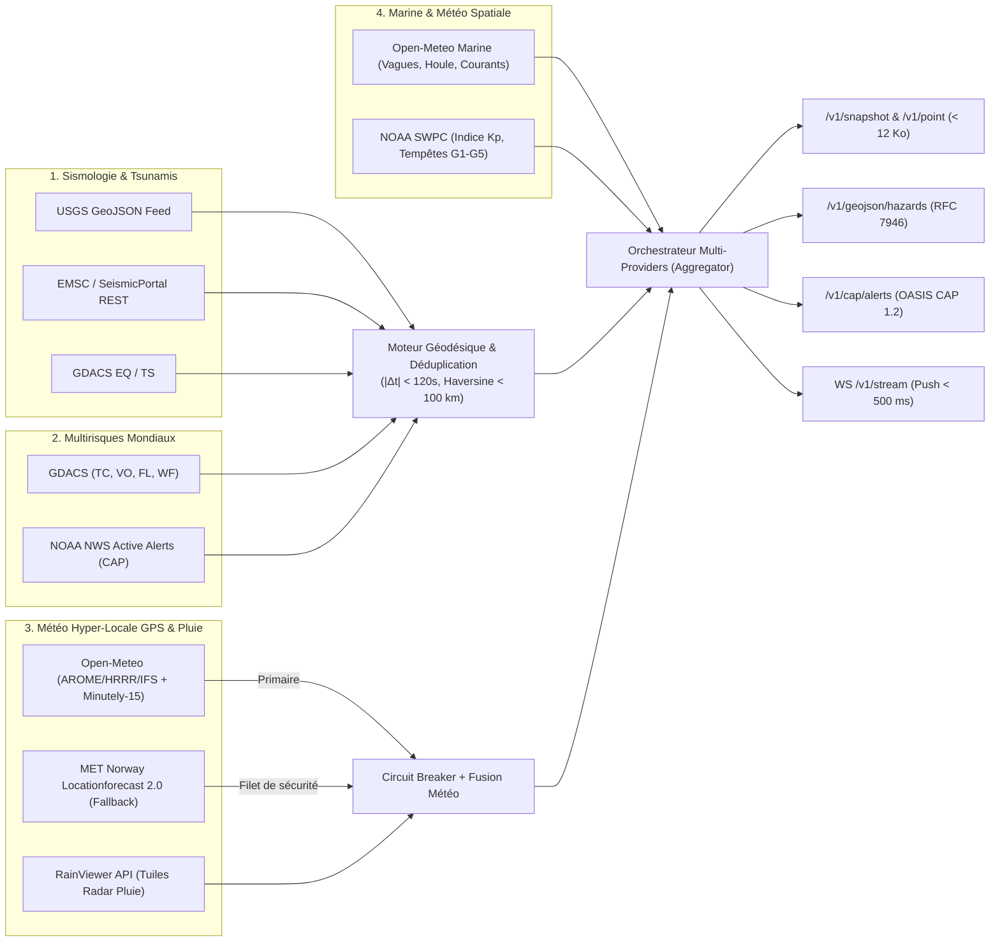

# Audit & Architecture de Conception — Vigie Mondiale API (`alerte_mondiale_api`)

> **Date :** `2026-10-18`
> **Portée :** Architecture industrielle multi-providers (Météo Hyper-Locale GPS/Marine & Catastrophes Naturelles Mondiales)
> **Conformité Standards :** OpenAPI 3.1 · IETF RFC 7946 (GeoJSON) · OASIS CAP 1.2 · Profil Embarqué ESP32-P4 (`< 12 Ko`)

---

## 1. Synthèse Exécutive & Positionnement Industriel

Une API d'alerte mondiale et de météo hyper-locale destinée à la fois à des **terminaux embarqués critiques** (ESP32-P4 Waveshare 7B en station fixe, véhicule ou navire avec GPS) et à des **systèmes d'information géographique / salles de crise (B2B/SaaS)** ne peut jamais dépendre d'un fournisseur unique par domaine.

Cet audit formalise une architecture **Multi-Providers à Haute Disponibilité** reposant sur :
1. **L'Interopérabilité Universelle** :
   - **OpenAPI 3.1** natif auto-documenté.
   - **RFC 7946 GeoJSON** (`GET /v1/geojson/hazards`) directement consommable par MapLibre GL, Leaflet, Mapbox, QGIS ou ArcGIS.
   - **OASIS CAP 1.2 (Common Alerting Protocol)** (`GET /v1/cap/alerts`) avec la taxonomie normalisée (`urgency`, `severity`, `certainty`, `category`, `event`, `area`) pour l'interconnexion avec les systèmes institutionnels de sécurité civile et sirènes d'alerte.
   - **Profil Embarqué Ultra-Compact (`GET /v1/snapshot` & `GET /v1/point`)** : Charge utile garantie `< 12 Ko` pour un décodage sans allocation dynamique sur microcontrôleur ESP32-P4.
2. **La Redondance Multi-Sources (Fusion & Filet de Sécurité / Fallback)** :
   - Chaque famille de risque ou de météo dispose d'au moins deux sources indépendantes ou d'un mécanisme de bascule automatique (Circuit Breaker + Cache mémoire TTL).
3. **La Précision Géodésique Temps Réel (Mode Bateau / Mobile GPS)** :
   - Interrogations au centième de degré (`lat`, `lon`), calcul de distance orthodromique (`Haversine`), **relèvement initial (cap en degrés et point cardinal `N`, `NE`, `E`...)** pour situer immédiatement la menace par rapport au porteur, et **estimation du temps d'arrivée d'un tsunami (ETA en minutes)** selon la loi de propagation en eau profonde ($v = \sqrt{g \cdot d} \approx 713\text{ km/h}$ à $4000\text{ m}$).

---

## 2. Matrice d'Architecture Multi-Providers & Fusion

### 2.1 Sismologie Mondiale : Fusion Tri-Sources (`USGS` + `EMSC` + `GDACS`)
* **Problème industriel** : L'USGS est la référence mondiale pour le niveau PAGER et le flag tsunami océanique, mais l'EMSC (Centre Sismologique Euro-Méditerranéen) détecte souvent les séismes européens, méditerranéens et asiatiques plus rapidement, tandis que GDACS évalue l'impact humanitaire. En interrogeant les trois sans filtrage, un même séisme majeur apparaît 3 fois.
* **Algorithme de Déduplication Spatiotemporelle (`deduplicate_hazards`)** :
  - Deux événements de catégorie `EARTHQUAKE` sont considérés comme le **même événement physique** si :
    $$|\Delta t| \le 120\text{ s} \quad \text{et} \quad d_{\text{Haversine}}(\text{lat}_1, \text{lon}_1, \text{lat}_2, \text{lon}_2) \le 100\text{ km}$$
  - **Règle de Fusion (Best-Score Merge)** :
    - On conserve la sévérité maximale (`RED > ORANGE > YELLOW > GREEN`).
    - On conserve la magnitude la plus élevée (`value_primary`), la profondeur la plus précise et l'activation du flag `tsunami_warning` (`True` si au moins une agence le lève).
    - On agrège la traçabilité dans `sources: ["USGS", "EMSC", "GDACS"]` (et `source: "USGS+EMSC+GDACS"`), augmentant le niveau de certitude (`certainty: "Observed"`).

### 2.2 Volcans, Tsunamis, Cyclones, Tornades, Inondations & Feux (`GDACS` + `NOAA NWS`)
* **Couverture globale** : `GDACS` couvre les événements majeurs mondiaux (`EQ`, `TS`, `VO`, `TC`, `FL`, `WF`).
* **Couverture haute résolution & côtière/maritime** : `NOAA NWS Active Alerts` (`/alerts/active`) fournit en format CAP/GeoJSON les alertes immédiates de tornades (`Tornado Warning`), ouragans (`Hurricane Warning`), tsunamis (`Tsunami Warning`) et crues éclair (`Flash Flood Warning`).

### 2.3 Météo Hyper-Locale par Coordonnées GPS & Pluie (`Open-Meteo` + Fallback `MET Norway` + `RainViewer`)
* **Précision au centième de degré (`0.01°` $\approx 1.1\text{ km}$)** : Indispensable pour un navire en mer, un véhicule en déplacement ou une propriété rurale soumise aux micro-climats.
* **Provider Primaire (`OpenMeteoCollector`)** :
  - Sélection automatique du meilleur modèle maille fine local (`best_match` combinant Météo-France AROME $1.5\text{ km}$, NOAA HRRR $3\text{ km}$, DWD ICON-D2 $2\text{ km}$, ECMWF IFS, JMA MSM).
  - Extraction des précipitations à **15 minutes (`minutely_15`)** pour le *Nowcasting* de pluie hyper-local (`rain_next_60m`), des conditions courantes et des prévisions à 10 jours.
* **Filet de Sécurité / Fallback Automatique (`MetNorwayCollector`)** :
  - Utilise l'API institutionnelle de l'Institut Météorologique Norvégien (`https://api.met.no/weatherapi/locationforecast/2.0/compact`), 100 % gratuite et mondiale (basée sur ECMWF + modèles nordiques haute résolution).
  - Si `Open-Meteo` échoue (timeout, erreur HTTP 5xx ou Circuit Breaker ouvert), `AggregatorService` bascule de manière transparente sur `MET Norway` sans interruption de service ni erreur côté client.
* **Radar de Pluie Mondial (`RainViewerCollector`)** :
  - Interroge `https://api.rainviewer.com/public/weather-maps.json` pour fournir les horodatages radar passés et les prévisions radar *nowcast* ainsi que le modèle d'URL de tuiles slippy map (`{host}{path}/256/{z}/{x}/{y}/2/1_1.png`).

### 2.4 Météo Marine & Océanographie (`OpenMeteoMarineCollector`)
* Pour tout appel avec `marine=true` sur `GET /v1/point` (mode Bateau / Navigation GPS) :
  - Hauteur significative des vagues (`wave_height_m`), direction (`wave_direction_deg`) et période (`wave_period_s`).
  - Houle primaire (`swell_wave_height_m`, `swell_wave_direction_deg`, `swell_wave_period_s`).
  - Vitesse et direction du courant océanique de surface (`ocean_current_velocity_kmh`, `ocean_current_direction_deg`).
  - Calcul automatique d'alerte de grain ou de mer dangereuse si les vagues dépassent $4.0\text{ m}$ ou si le vent dépasse les seuils de coup de vent/tempête.

### 2.5 Météo Spatiale (`NOAASWPCCollector`)
* Critique pour les bateaux en haute mer et les expéditions utilisant le positionnement **GNSS/GPS** et les **communications radio HF/VHF** :
  - Lecture de l'indice planétaire géomagnétique $K_p$ (`0.0` à `9.0`).
  - Classification automatique sur l'échelle NOAA (`G0` à `G5`) et indicateurs booléens d'impact opérationnel (`gps_degraded`, `hf_radio_blackout_risk`).

---

## 3. Résilience Industrielle : Circuit Breaker & Cache TTL

Chaque collecteur hérite de `BaseCollector` (`app/collectors/base.py`) qui implémente une machine à états **Circuit Breaker** à 3 états :
1. **`CLOSED` (Nominal)** : Les requêtes HTTP asynchrones (`httpx.AsyncClient`) sont exécutées normalement. Le résultat valide est mis en cache mémoire avec un `ttl_seconds` adapté à la physique du phénomène (`60s` pour la sismologie, `180s` pour GDACS, `300s` pour la météo).
2. **`OPEN` (Disjoncté)** : Après `failure_threshold` échecs consécutifs (défaut : `3`), le disjoncteur s'ouvre pendant `recovery_timeout_seconds` (défaut : `60s`). Pendant cette phase, aucun appel réseau bloquant n'est tenté : le collecteur retourne immédiatement sa dernière valeur valide en cache (`last_good_data`) ou passe la main au provider de fallback.
3. **`HALF_OPEN` (Sonde de rétablissement)** : À l'expiration du délai de recouvrement, un appel sonde est autorisé. S'il réussit, le circuit repasse en `CLOSED` ; s'il échoue, il repart en `OPEN`.

Tous les états de santé (latence EMA en ms, compteur d'échecs, âge du cache, statut du circuit) sont exposés en temps réel sur `GET /v1/providers` et `GET /v1/health`.

---

## 4. Géodésie Marine & Terrestre Embarquée (`app/services/geodesy.py`)

Pour un équipement mobile (bateau avec GPS fournissant `lat`, `lon`, `sog_knots` *Speed Over Ground*, `cog_deg` *Course Over Ground*) ou une liste de zones surveillées :
- **Distance orthodromique (`haversine_km`)** : Calcul exact sur sphère terrestre ($R = 6371.0088\text{ km}$).
- **Relèvement initial (`initial_bearing_deg` & `bearing_to_cardinal`)** : Donne l'azimut exact ($0^\circ\text{–}360^\circ$) et le point cardinal à 16 ou 8 directions (`N`, `NE`, `E`, `SE`, `S`, `SW`, `W`, `NW`) vers l'épicentre de la menace depuis la position GPS.
- **ETA Tsunami (`estimate_tsunami_eta_minutes`)** : Lorsqu'un séisme sous-marin ou côtier lève `tsunami_warning = true`, calcule le temps théorique de propagation de l'onde de gravité :
  $$c = \sqrt{g \cdot H} \quad (\text{avec } g = 9.80665\text{ m/s}^2, \; H \approx 4000\text{ m} \implies c \approx 198\text{ m/s} \approx 713\text{ km/h})$$
  En ajoutant une marge de sécurité côtière, le terminal affiche immédiatement `ETA Tsunami : ~XX min` pour permettre une mise en sécurité d'urgence.
